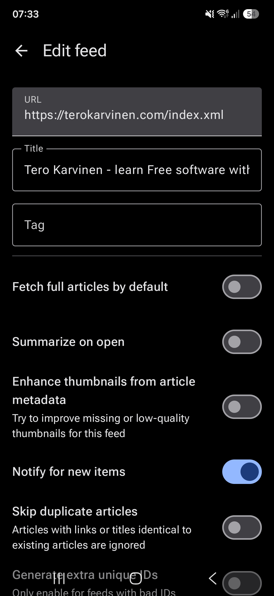
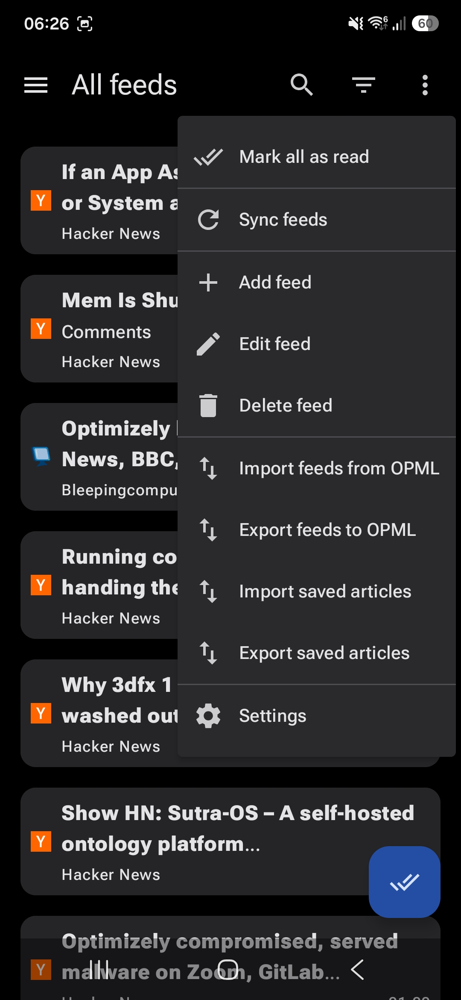
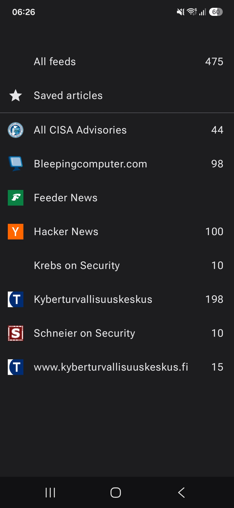
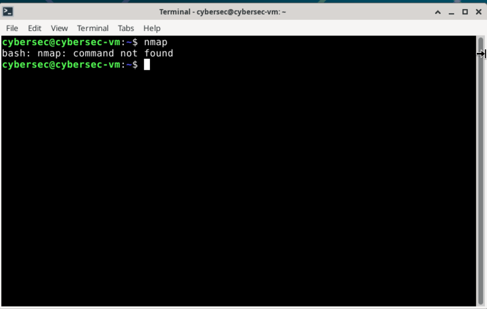
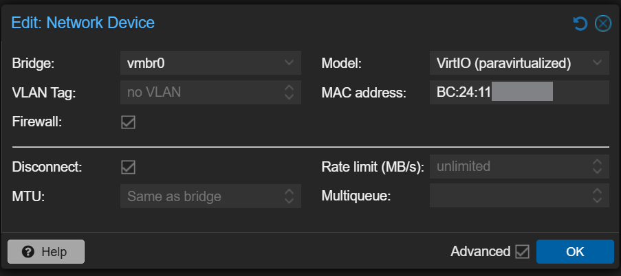
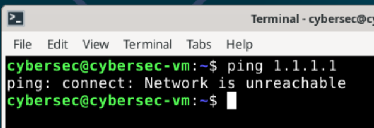
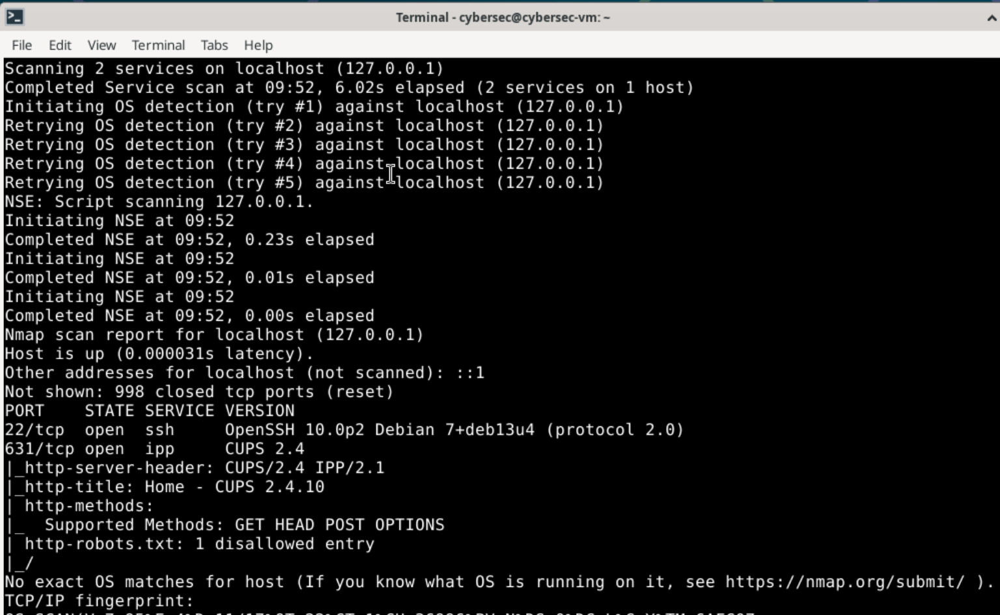
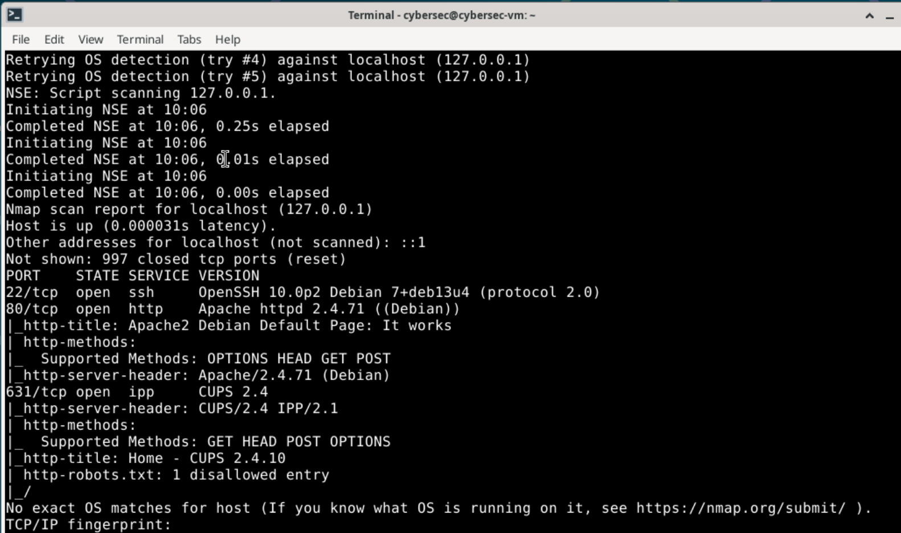

# H4 - Feed Me

If you follow multiple news sources, blogs, or other publications, an RSS/Atom feed reader is an efficient way to keep track of them. Feed readers are particularly useful for monitoring cybersecurity-related content, such as announcements of CVE vulnerabilities, cybersecurity news, and updates to cloud platforms. Some of the benefits of RSS/Atom feeds include:

* All your preferred publications are collected into a single view, making them quick and easy to browse.
* You can see the latest publications in chronological order and receive notifications about new content.
* Important posts are not hidden due to social media algorithms.
* You are likely to encounter fewer advertisements.

RSS stands for Really Simple Syndication. Atom is a newer standard introduced in the 2000s by the Internet Engineering Task Force (IETF). Both formats use XML syntax, and most feed readers support both RSS and Atom feeds.


## Part 1 - Choosing and installing feed reader

I wanted to find an RSS feed reader app for Android because the most common situations for reading feeds are when I am on the go. My requirements for the application were: no advertisements, no account creation or login required, notifications, and preferably open source.

I searched for alternatives on Google using the keywords "rss feed reader android open source" and decided to try Feeder by noNonsenseApps, which can be downloaded from both the Google Play Store and F-Droid app stores.

### Adding feeds
 
To add new feed you need to type in the feed URL and select optional settings like notifications.

 

Adding a feed


Overview of a added feed

The Feeder seems to fetch feeds and display them correctly.

I added two more required by the task feeds:

* Krebs security - https://krebsonsecurity.com/feed/
* Schneier on Security - https://schneier.com/feed/atom

Added two more feeds. First one from Traficom National Cyber Security Centre Finland which has news and some other security related topics conserning expecially EU and Finland region.

Second feed is from an American startup accelerator and venture capital firm Y Combinator. Someone recommended these news years ago and I wanted to see if I found it useful today. 

* Alerts from Kyberturvallisuuskeskus - https://kyberturvallisuuskeskus.fi/feed/rss/fi/401
* Hacker news from Y Combinator - https://news.ycombinator.com/rss

 

Overview of all feeds and list of feeds subscribed




### Following feeds

I started using the Feeder application at the end of October 2026, and my first observation was that the number of headlines, especially in the summary view, can quickly become very large. Some feeds may receive several new posts per day, and not all of them are necessarily important. Many services offer multiple feeds, allowing you to select the most relevant ones. For example, in the case of Traficom, you can subscribe only to Alert feeds. In the application I chose, feeds can also be grouped or categorized using tags, making it possible to browse them by topic area.

In general, following news and announcements through RSS feeds is significantly more efficient, and the Feeder application provides sufficient customization options. In addition, you can configure notifications for specific categories you are interested in, which would otherwise be difficult to achieve through a single application.


## Part 2 - Port scan with nmap

I used the same virtual machine for the port scanning experiments that I had installed as part of the H3 – Cyber Lab assignment. First, I checked whether Nmap was already present by entering the nmap command in the terminal.



The package was not installed, so I installed it using the following command:

```
sudo apt update; sudo apt -y install nmap
```
Because the scan is performed only against the local virtual machine, it is recommended to disconnect the network connection to prevent any accidental impact on other systems. In the Proxmox virtual environment, this can be done from the virtual machine's Hardware view by modifying the Network Device settings. In this case, the virtual machine has only one network adapter. If multiple network adapters are present, the network connection should be disconnected for all of them.



Testing if network is disconnected by pinging DNS server operated by Cloudflare.



Then we run nmap against localhost with arguments -A to enable OS and version detection and -v to increase verbosity level.

```
sudo nmap -A -v localhost
```



First nmap run found two open ports out of 1000. Port 22 was expected because I installed SSH server in previous H3 task for more convinient remote access. However CUPS listening on port 631 was not expected. OS detecting did not work, but SSH service reviels some information about the OS.

Next I reconnected the network for installing Apache and started install using command:

```
sudo apt -y install apache2
```
After disconnecting network again we run nmap again with same arguments than previously.



After second run we can see that Apache2 service is listening on port 80 and we can see Apache version and title of index -page.

### X) Case: Port scanning Osuuspankkikeskus

This case concerned Person A, who in 1998 conducted a port scan from Helsinki targeting all internet-facing addresses of a cooperative. According to the charge, the purpose was to identify open proxy servers that could be used to establish further connections while making it appear that the traffic originated from the proxy server rather than from the actual user.

* A significant amount of port-scan data and related lists were found on Person A’s computer.
* The District Court dismissed the charge of attempted unauthorized access because it considered it possible that someone else could have established the connections and made them appear as though they originated from Person A’s computer.
* The prosecutor appealed the case to the Court of Appeal, which found Person A guilty of attempted unauthorized access. The court held that it was undisputed that the connections originated from his IP address and that he had been investigating opportunities to gain access to information systems. The court considered it implausible that the scanning had been performed for any purpose other than attempting to penetrate a system.
* Person A appealed to the Supreme Court, requesting that both the criminal charge and the claim for damages be dismissed and, alternatively, that any damages be reduced.
* The Supreme Court upheld the decision of the Court of Appeal


## References

Feeder news - https://news.nononsenseapps.com/

Tero Karvinen Cyber Security - 2026 late autumn - https://terokarvinen.com/cyber-security/

Ennakkopäätökset KKO:2003:36 - https://www.finlex.fi/fi/oikeuskaytanto/korkein-oikeus/ennakkopaatokset/2003/36
